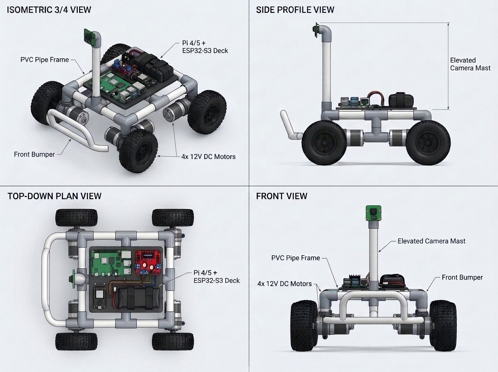
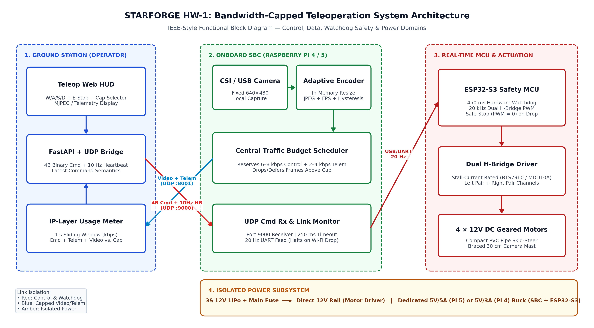
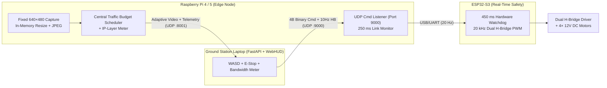
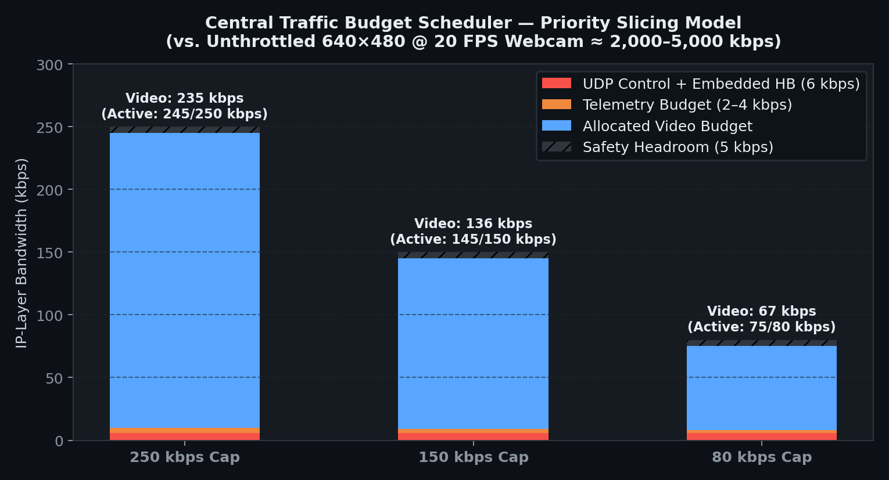
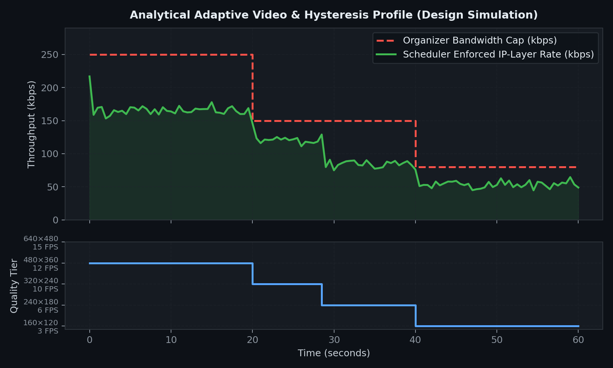
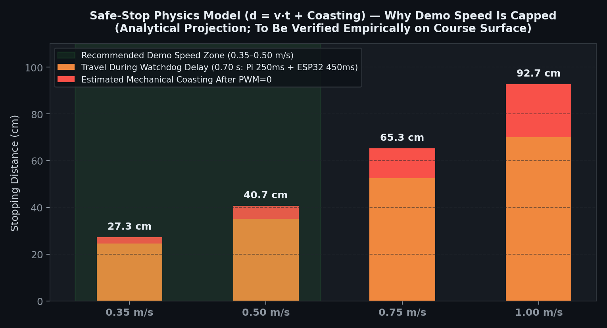

<div align="center">

# STARFORGE 2026 — Bandwidth-Capped Teleoperated Rover
### Hardware Track (`HW-1`) • BMS Institute of Technology & Management (BMSIT&M)

[](STARFORGE_HW1_REPORT.md)
[](rover_pi/)
[](esp32_s3_firmware/)
[](ground_station/)
[](requirements.txt)

*A low-latency, bandwidth-budgeted planetary teleoperation rover featuring a Central Traffic Budget Scheduler, seamless in-memory adaptive video with hysteresis, isolated UDP binary control, and a 3-stage hardware watchdog safe-stop.*

---

[Overview](#-mission-overview--hw-1-requirements) •
[Rover Design](#-mechanical-design-pvc-pipe-spaceframe) •
[Architecture](#-system--network-architecture) •
[Engineering Plots](#-analytical-design-models--projections) •
[24-Hr Build Plan](#-phased-24-hour-execution-plan) •
[Quickstart](#-quickstart-mock--hardware-mode)

</div>

---

## 🎯 Mission Overview & HW-1 Requirements

In planetary teleoperation (Moon/Mars), video, telemetry, and motor commands share a **narrow, bandwidth-capped wireless link**. Standard webcam streams (`2,000–5,000 kbps`) immediately breach organizer caps, cause multi-second buffering lag, and starve `STOP` commands.

| HW-1 Expected Outcome | Our Engineering Solution | Verification Target |
| :--- | :--- | :--- |
| **Rover with motor control, camera & wireless link** | 4 × 12V DC motors via stall-rated dual H-bridge + **ESP32-S3** + **Raspberry Pi 4/5** + CSI/USB camera over dedicated Wi-Fi hotspot | Smooth `W/A/S/D` driving via live camera feed |
| **Real-time data usage meter** | **IP-Layer / Interface-Level Meter** tracking **Commands + Telemetry + Video** over a 1 s sliding window | Validated against `tcpdump` / Wireshark |
| **Dynamic bandwidth management** | **Central Traffic Budget Scheduler** + per-frame `cv2.resize` / JPEG quality / FPS scaling with **hysteresis** & **drop-frame guard** | Benchmarked at `250`, `150`, and `80 kbps` caps |
| **Course completion & safe stop on link drop** | Braced ~30 cm camera mast + controlled speed (`0.35–0.50 m/s`) + **3-Stage Watchdog Chain** | Measure timeout → PWM cutoff → physical stop distance |

---

## 🛠️ Mechanical Design: PVC Pipe Spaceframe

Built for rapid 24-hour assembly using a compact square PVC pipe frame (`wheelbase ≈ track width` for low-scrub 4-wheel skid-steer turning), a **diagonally braced ~30 cm camera mast** to prevent vibration blur, and a curved front bumper:

<div align="center">
  
  <br />
  <sub><b>Figure 1:</b> 4-angle engineering concept gallery — Isometric 3/4, Side Elevation, Top Plan, and Front views.</sub>
</div>

---

## ⚙️ System & Network Architecture

High-level vision and network scheduling run on the **Raspberry Pi**, while real-time PWM and link-loss safety live on the **ESP32-S3**:

<div align="center">
  
  <br />
  <sub><b>Figure 2:</b> IEEE-style functional block diagram showing isolated Ground Station, Onboard SBC, Real-Time Safety MCU, and Power domains.</sub>
</div>



### Key Architectural Decisions
- **Separate UDP Control Socket (`:9000`):** Eliminates application-level head-of-line blocking behind video frames (`32 B` IPv4/UDP packet @ `10–20 Hz` = `2.56–5.12 kbps`, `6–8 kbps` reserved). *Note: Both flows still share Wi-Fi airtime; steering latency is benchmarked under max video load.*
- **Seamless In-Memory Video Adaptation:** Camera stays open at fixed `640×480`; resolution (`640×480` → `160×120`), FPS (`15` → `3`), and JPEG quality (`70` → `18`) adapt **on the very next frame** without restarting the camera or breaking the decoder.

---

## 📊 Analytical Design Models & Projections

> **Note on Honest Engineering:** The plots below are **analytical design projections** used to size our scheduler and speed limits prior to hardware benchmarking. Empirical measurements from the physical rover (`250 / 150 / 80 kbps` runs and surface stopping tests) will be logged in Phase 2.

### 1. Central Traffic Budget Scheduler (Priority Slicing)
Every 1-second window reserves control (`6 kbps`) and telemetry (`2–4 kbps`) **first**, then allocates leftover bytes to video and drops frames that would breach the cap.

<div align="center">
  
</div>

### 2. Adaptive Video & Hysteresis Stability
To avoid quality flicker near the cap, the controller **steps down fast** (`> 85%` utilization) and **steps up slowly** (`< 55%` sustained for `2.0 s`).

<div align="center">
  
</div>

### 3. Safe-Stop Physics (`d = v · t + coasting`)
Because motor power cutoff (`Pi 250 ms + ESP32 450 ms = 0.70 s`) happens *before* mechanical braking, demo speed is capped at **`0.35–0.50 m/s`** to keep stopping distance tight on the obstacle course.

<div align="center">
  
</div>

---

## ⚡ Hardware & Power Audit Checklist

Before final assembly, verify:
- [ ] **Motor Stall Current:** Measure/verify stall current per 12V motor (`2×` per side in parallel).
- [ ] **Driver Continuous Rating:** Use a high-current driver (`BTS7960` / `Cytron MDD10A`) sized for continuous stall/turn current without thermal shutdown.
- [ ] **Separate Regulated 5V Rail:** `5V / 3A` (Pi 4) or **`5V / 5A` USB-C PD** (Pi 5) isolated from 12V motor voltage sag, plus inline fuse & proper wire gauge.
- [ ] **3-Event Safe-Stop Test:** Measure **(1)** link-loss-to-timeout, **(2)** timeout-to-PWM-cutoff, and **(3)** physical stopping distance on the test surface.

---

## 🗓️ Phased 24-Hour Execution Plan

- **Phase 0 (Hours 0–6) — Minimum Drivable Rover:** PVC frame + motor wiring + ESP32-S3 watchdog + basic UDP `W/A/S/D` + fixed-quality video + verified link-drop stop.
- **Phase 1 (Hours 6–12) — Graded HW-1 Core:** Central Traffic Budget Scheduler + IP-layer bandwidth meter (validated with packet capture) + seamless per-frame adaptive video with hysteresis.
- **Phase 2 (Hours 12–18) — Benchmarking & Course Tuning:** Log `250 / 150 / 80 kbps` cap runs, steering latency under load, and physical stopping distance.
- **Phase 3 (Hours 18–24) — Demo Rehearsal & Stretch:** Full obstacle course rehearsal; optional **ExecuTorch (`MobileNetV3-Small` `.pte`) collision-warning co-pilot** only if Phases 0–2 are 100% stable.

---

## 🚀 Quickstart (Mock & Hardware Mode)

### 1. Install Dependencies
```bash
pip install -r requirements.txt
```

### 2. Test Locally on Your Laptop (`--mock` Mode)
Open two terminals:
```bash
# Terminal 1: Simulated Rover Node (no Pi/ESP32 required)
python rover_pi/rover_node.py --mock --ground-ip 127.0.0.1 --cap-kbps 250

# Terminal 2: Ground Station Web HUD
python ground_station/app.py --rover-ip 127.0.0.1
```
Then open **http://localhost:8000** in your browser to test live bandwidth cap switching (`250 / 150 / 80 kbps`), `W/A/S/D` driving, and `Spacebar` E-Stop.

### 3. Deploy to Physical Rover
1. Flash [`esp32_s3_firmware/starforge_rover_esp32s3/starforge_rover_esp32s3.ino`](esp32_s3_firmware/starforge_rover_esp32s3/starforge_rover_esp32s3.ino) to your **ESP32-S3**.
2. Connect the **ESP32-S3** to your **Raspberry Pi 4/5** over USB (`/dev/ttyACM0`).
3. Run `rover_node.py` on the Pi pointing to your laptop's hotspot IP, and `ground_station/app.py` on your laptop pointing to the Pi's IP.

---

## 📁 Repository Structure

```text
├── assets/                          # Rover gallery & analytical engineering plots
├── esp32_s3_firmware/               # ESP32-S3 20 kHz PWM + 450 ms hardware watchdog
├── ground_station/                  # FastAPI Ground Station & Web HUD
├── rover_pi/                        # Pi edge node & Central Traffic Budget Scheduler
├── scripts/                         # Plot generation utilities
├── STARFORGE_HW1_REPORT.md          # Detailed technical report & traceability matrix
└── STARFORGE_TEMPLATE.pptx          # Official Round 1 pitch deck template
```
